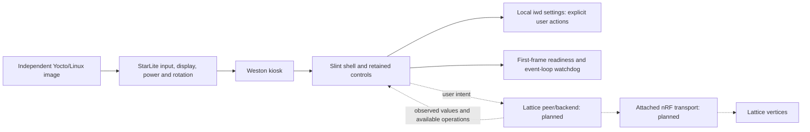

# Tablet architecture

This is the independent OS/application foundation for a Lattice tablet. The
StarLite runs its own Linux image, Weston kiosk, platform services, and Slint
frontend. Its boot partition, root filesystems, persistent state, hostname,
application/service identifiers, and build directories belong to this installation.

The target installation is vertices plus a tablet peer. The tablet discovers
progressively from a reachable contact, follows maintained links, reads selected
appliance surfaces/current state, invokes native transformers, and consumes deltas.
An attached nRF supplies radio access. The USB/protocol division between that MCU
and the Linux peer is the next implementation decision; this foundation implements
neither a radio bridge nor a peer daemon yet. No central compiler is required.

The UI contains tablet-owned presentation records and opaque interaction handles.
It must not require a complete network inventory before becoming useful. Discovery
and state/command semantics will be Lattice-native; there is no compatibility
replica of the former server's projection model. Names, room placement, and UI
semantics still need an explicit owner when the backend is added; mathematical
scalar definitions alone do not identify a light, fan, or room.

The frontend starts with no fabricated appliances and unknown aggregate state.
Wi-Fi scans occur only after the user's explicit refresh action. Image builds do
not require an operational Lattice network, and frontend readiness means a rendered
frame, not connectivity. Appliance control callbacks are retained for backend
integration; no operational controls are populated by the foundation.

Platform services are separate from peer behavior. The existing rotation/backlight
module belongs to Weston; the image's Linux configuration and patches belong under
recipes-kernel. Future kernel modules can be added to this image without a shared
installation or runtime mode with the source application from which it was extracted.
The backend's local API and process boundaries will be chosen with its implementation,
not preemptively expanded into a general service framework.
