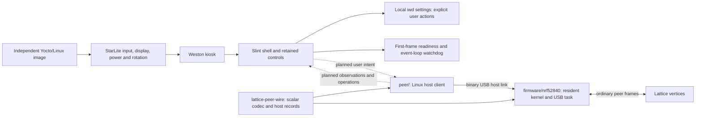

# Tablet architecture

This is the independent OS/application foundation for a Lattice tablet. The
StarLite runs its own Linux image, Weston kiosk, platform services, and Slint
frontend. Its boot partition, root filesystems, persistent state, hostname,
application/service identifiers, and build directories belong to this installation.

The target installation is vertices plus a tablet peer. The tablet discovers
progressively from a reachable contact, follows maintained links, reads selected
appliance surfaces/current state, invokes native transformers, and consumes deltas.
The attached nRF and Linux host use one resident network identity. The nRF runs
the ordinary kernel's formation, link maintenance, forwarding, and radio work;
`peer/` is a Linux client for its optional local host endpoint. Binary USB status
and local/remote links, surface/state reads, and native invocation are implemented.
The full path has run on two nRFs with a software dimmer appliance. Host delta
streaming, continuous daemon behavior, and frontend integration remain next. No central compiler is required.

The UI contains tablet-owned presentation records and opaque interaction handles.
It must not require a complete network inventory before becoming useful. Discovery
and state/command semantics remain Lattice-native; there is no compatibility
replica of the former server's projection model. Names, room placement, and UI
semantics still need an explicit owner when the backend is added; mathematical
scalar definitions alone do not identify a light, fan, or room.

The frontend starts with no fabricated appliances and unknown aggregate state.
Wi-Fi scans occur only after the user's explicit refresh action. Image builds do
not require an operational Lattice network, and frontend readiness means a rendered
frame, not connectivity. Appliance control callbacks are retained for backend
integration; no operational controls are populated by the foundation.

Platform services are separate from peer behavior. The existing rotation/backlight
module belongs to Weston; the image's Linux configuration and patches belong under
recipes-kernel. Future kernel modules can be added to this image without a shared
installation or runtime mode with the source application from which it was extracted.
The backend is currently a library and CLI, separate from the Slint process. Its
service/UI boundary will be added when those operations exist. USB framing and scalar encoding belong to the shared codec, host admission/read completion to the common kernel, USB
peripheral setup to the XIAO application, and Linux descriptor handling to `peer/`.
No runtime dependency points at a sibling working checkout or a lab directory.

The Linux consumer requests complete immutable surface bytes and exposes a
`SurfaceSummary` for declaration/type inspection; the full raw mathematics remains
available to future IR consumers. Native outcomes and registered state are distinct.
The client never retries a mutation automatically or substitutes its success status
for a state observation. It does not maintain a global foreign-state mirror.

The final pinned image passed the full operation sequence and a later read with
the remote diagnostic console closed. Earlier closed-console and post-reflash
reads timed out; console state alone was not established as their cause. A concrete
read-token reuse defect across MCU restart was corrected. Functional validation
still does not establish delivery reliability or justify automatic mutation retries.
